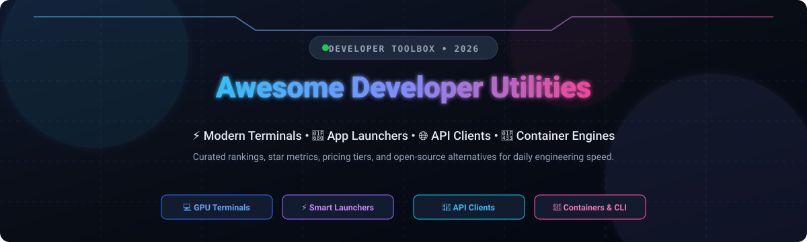

# Awesome-Developer-Utilities

<p align="center">
  
</p>

<p align="center">
  <a href="https://github.com/ishandutta2007/Awesome-Awesome-Awesome"></a>
  <a href="https://discord.gg/jc4xtF58Ve"></a>
  <a href="https://github.com/ishandutta2007/Awesome-Developer-Utilities/stargazers"></a>
  <a href="https://github.com/ishandutta2007/Awesome-Developer-Utilities/network/members"></a>
  <a href="https://github.com/ishandutta2007/Awesome-Developer-Utilities/blob/main/LICENSE"></a>
  <a href="https://github.com/ishandutta2007"></a>
</p>

---

## ⚡ Top Developer Utilities Ecosystem

**A Curated Directory of High-Performance SaaS Platforms & Open-Source GitHub Projects**  
*Comprehensive benchmarks, starting tier pricing, free tier limits, star badges, and developer tooling alternatives for Launchers, API Clients, Container Engines, Terminals, and Command-Line Productivity.*

> **Last updated:** October 2026 🗓️  
> **Keywords / SEO:** developer utilities, developer tools, dev tools 2026, terminal emulators, API testing clients, Postman open source alternative, Docker Desktop alternative, Raycast alternative, command line tools, local first devtools.

This repository tracks notable **SaaS platforms** and **open-source projects** for **Developer Utilities**. These essential daily-driver tools empower software engineers, DevOps teams, and hackers to move faster—launching apps and files at the speed of thought, testing REST/GraphQL APIs, managing container clusters locally, and navigating lightning-fast GPU-accelerated terminal environments.

---

## 📑 Table of Contents

- [📊 Sector Overview & Market Dynamics](#-sector-overview--market-dynamics)
- [💼 SaaS/Hosted Platforms](#-saashosted-platforms)
- [🌟 Open-Source GitHub Projects](#-open-source-github-projects)
- [🛠️ Frameworks & Recommended Stacks](#️-frameworks--recommended-stacks)
- [🤝 How to Contribute](#-how-to-contribute)
- [⚠️ Disclaimer & Architectural Trade-Offs](#️-disclaimer--architectural-trade-offs)
- [📈 Star History](#-star-history)
- [💖 Support & Sponsorship](#-support--sponsorship)

---

## 📊 Sector Overview & Market Dynamics

The global developer utilities and software development tools market is estimated at approximately **$7.5B to $9.0B**, expanding rapidly at a **14%–16% CAGR** toward **$30B+ by the mid-2030s**. 

The sector is **highly fragmented** rather than winner-take-all:
- **Modular Stacks:** Modern engineering organizations reject rigid monolithic suites, instead stitching together best-of-breed specialized utilities for specific daily workflows (such as combining Alacritty or Ghostty with Lazygit, Starship, and Hoppscotch).
- **Product-Led Growth (PLG) & Open Core:** Individual developers choose lightweight, bottom-up tools with near-zero initial friction, creating stubborn organic adoption before enterprises upgrade for team governance, centralized management, and cloud synchronization.
- **The AI Layer Shift:** Established commercial tools are racing to integrate AI agents and cloud credits directly into command bars and terminals, opening up opportunities for local-first, vendor-independent open-source alternatives.

---

## 💼 SaaS/Hosted Platforms

The table below benchmarks prominent commercial developer utilities, ordered by company valuation / scale (descending):

| 🚀 Product | 🏢 Company Valuation / Revenue | 💳 Starting Pricing Tier | 🎁 Free Tier Limits | 📝 Description |
| :--- | :--- | :--- | :--- | :--- |
| **Postman** | **$5.6B valuation** (~$313M ARR) | $9/user/month (Solo, billed annually) or $19/user/month (Team) | **Free forever plan limited to 1 user** (no shared team workspaces/collaboration), 50 Postman AI credits/month, and 10,000 API calls/month | Leading API collaboration platform with collections, workspaces, and mock servers. |
| **Docker Desktop** | **$2.1B valuation** (~$207M ARR) | $9/user/month (Pro, billed annually) or $15/user/month (Team) | **Free forever Personal plan restricted to small businesses (<250 employees & <$10M annual revenue)**, education, open-source, or personal use; includes 1 private repo and 1 user seat | Standard GUI container management application for Mac, Windows, and Linux. |
| **Insomnia (Kong)** | **$2.0B valuation** (~$100M+ ARR) | $12/user/month (Pro, billed annually) | **Free forever Essentials plan capped at 1,000 mock requests/month** and 3 users on Git Sync projects; includes offline Scratch Pad mode | Open-source foundation API client and debugging suite backed by Kong. |
| **Warp** | **~$293.5M valuation** (~$75M raised) | $18/user/month (Build plan, billed annually) | **Free forever plan with unlimited core terminal access**, but has 0 bundled recurring monthly AI agent credits (requires pay-as-you-go or bring-your-own inference) and restricted cloud history/indexing | Modern Rust-based, AI-integrated terminal emulator with collaborative command workflows. |
| **Raycast** | **~$120M–$250M valuation** (~$5M–$10M ARR) | $10/user/month (Pro) | **Free forever plan with 0 native Raycast AI access**, maximum of 5 Raycast Notes, and no cloud sync (local storage only) | Highly extensible Mac/Windows launcher with deep script integrations and quicklinks. |
| **Setapp (MacPaw)** | **~$90M annual revenue** (~$13.5M Setapp ARR) | $14.99/month (1 Mac plan) | **No free-forever tier; 7-day free trial** with full access to 270+ apps and 90 AI credits (payment method required) | Mac and iOS utility subscription marketplace granting all-in-one access to curated applications. |
| **Termius** | **~$4M annual revenue** (Bootstrapped / YC seed) | $10/user/month (Pro, billed annually) | **Free forever Starter plan with local vault only (0 cloud sync across devices)** and no shared team vaults; allows 1 user device manual setup | Cross-platform SSH, SFTP, and Telnet client with terminal emulator capabilities. |
| **Chocolatey** | **~$1.7M annual revenue** (Privately held / bootstrapped) | $17.60/machine/year (Chocolatey for Business) or $96/year (Pro Personal) | **Free forever Open Source edition allowed for commercial use on unlimited machines**, but excludes centralized management (CCM), automatic package builders, and private package internalizers | Windows package manager and automation utility for software deployment. |
| **Alfred** | **Privately held micro-ISV** (~$500K–$2M revenue estimate) | £34 one-time (~$43 USD single license) | **Free forever basic edition restricted to Spotlight-style search only**; completely excludes Alfred Workflows, clipboard history, and text expansion snippets | Original native macOS application launcher and workflow productivity engine. |

---

## 🌟 Open-Source GitHub Projects

Curated top-tier open-source developer utilities ranked by GitHub stargazers count (descending):

1. **[fzf](https://github.com/junegunn/fzf)** [](https://github.com/junegunn/fzf/stargazers) `MIT` 🌸  
   *An interactive, blazing-fast Unix command-line fuzzy finder for files, history, and processes.*
   - **Key Features:** Portable, zero dependencies, comprehensive shell integration (bash, zsh, fish), and flexible fzf-tmux wrappers.
   - **Best for:** Developers looking to rapidly jump through directory trees, git commits, and shell history.

2. **[Lazygit](https://github.com/jesseduffield/lazygit)** [](https://github.com/jesseduffield/lazygit/stargazers) `MIT` 📦  
   *Simple, keyboard-driven terminal UI for everyday git operations.*
   - **Key Features:** Visual interactive rebasing, rapid stage/unstage by line or hunk, conflict resolution, and branching visualization right in your terminal.
   - **Best for:** Engineers who want visual Git branch inspection without leaving terminal sessions.

3. **[Hoppscotch](https://github.com/hoppscotch/hoppscotch)** [](https://github.com/hoppscotch/hoppscotch/stargazers) `MIT` 🌐  
   *Open-source API development ecosystem—the premier community alternative to Postman and Insomnia.*
   - **Key Features:** Lightweight web app, self-hostable instance, desktop builds, WebSocket/GraphQL/SSE/gRPC testing, and offline-first workflows.
   - **Best for:** Teams and individual developers seeking full API testing suites without mandatory accounts or vendor paywalls.

4. **[code-server](https://github.com/coder/code-server)** [](https://github.com/coder/code-server/stargazers) `MIT` 💻  
   *Run Visual Studio Code on remote cloud servers and access it straight from any web browser.*
   - **Key Features:** Consistent remote development environments, iPad/Chromebook compatibility, shared team workspaces, and zero compute drain on client machines.
   - **Best for:** Remote development, self-hosted coding workstations, and cloud environments.

5. **[Alacritty](https://github.com/alacritty/alacritty)** [](https://github.com/alacritty/alacritty/stargazers) `Apache-2.0` ⚡  
   *Cross-platform, GPU-accelerated OpenGL terminal emulator focused purely on extreme speed and simplicity.*
   - **Key Features:** Raw rendering performance, low memory footprint, declarative YAML/TOML configuration, and zero bloat.
   - **Best for:** Developers who demand maximum terminal responsiveness and prefer pairing with tmux or Zellij for window tiling.

6. **[Ghostty](https://github.com/ghostty-org/ghostty)** [](https://github.com/ghostty-org/ghostty/stargazers) `MIT` 👻  
   *Fast, feature-rich, cross-platform terminal emulator created by Mitchell Hashimoto (HashiCorp co-founder).*
   - **Key Features:** Platform-native UI widgets, GPU hardware acceleration, low-latency input pipeline, native tabs/splits, and declarative config reload.
   - **Best for:** Developers looking for a polished terminal combining native OS aesthetics with blistering speed.

7. **[bat](https://github.com/sharkdp/bat)** [](https://github.com/sharkdp/bat/stargazers) `Apache-2.0` 🦇  
   *A cat(1) clone with syntax highlighting and Git integration.*
   - **Key Features:** Automatic syntax highlighting for hundreds of languages, Git modification badges, automatic paging, and seamless pipeline pass-through.
   - **Best for:** Replacing default `cat` across all interactive terminal workflows.

8. **[Starship](https://github.com/starship/starship)** [](https://github.com/starship/starship/stargazers) `ISC` 🚀  
   *The minimal, blazing-fast, and infinitely customizable cross-shell prompt written in Rust.*
   - **Key Features:** Sub-millisecond rendering, supports Bash, Zsh, Fish, PowerShell, and Nushell; detects runtime versions and Git repo status automatically.
   - **Best for:** Giving any developer terminal an intelligent, context-aware shell prompt.

9. **[Homebrew](https://github.com/Homebrew/brew)** [](https://github.com/Homebrew/brew/stargazers) `BSD-2-Clause` 🍺  
   *The de facto standard package manager for macOS and Linux.*
   - **Key Features:** Manages thousands of CLI utilities, GUI applications (via Casks), and developer runtimes through simple `brew` recipes.
   - **Best for:** Universal environment bootstrapping on macOS and Linux machines.

10. **[Bruno](https://github.com/usebruno/bruno)** [](https://github.com/usebruno/bruno/stargazers) `MIT` 🐕  
    *Fast and git-friendly open-source API client that stores collections directly in local filesystem folders.*
    - **Key Features:** Local Bru markup format, version controlled with plain Git, zero mandatory cloud accounts, and intuitive visual GUI.
    - **Best for:** Teams who want Postman/Insomnia parity with version control baked straight into their Git repositories.

11. **[Zellij](https://github.com/zellij-org/zellij)** [](https://github.com/zellij-org/zellij/stargazers) `MIT` 🎛️  
    *A modern terminal workspace and multiplexer with batteries included.*
    - **Key Features:** Intuitive discoverable UI hints, customizable split layouts, WebAssembly (WASM) plugin ecosystem, and detached session recovery.
    - **Best for:** Developers looking for a user-friendly, out-of-the-box alternative to tmux.

12. **[Kitty](https://github.com/kovidgoyal/kitty)** [](https://github.com/kovidgoyal/kitty/stargazers) `GPL-3.0` 🐱  
    *Cross-platform, GPU-accelerated terminal emulator with comprehensive graphic and image support.*
    - **Key Features:** Inline graphics protocol, tabs, splits, remote control scripting, and font ligature handling.
    - **Best for:** Power terminal users who want speed combined with native window layouts and media previewing.

13. **[Podman](https://github.com/containers/podman)** [](https://github.com/containers/podman/stargazers) `Apache-2.0` 🦭  
    *Daemonless, rootless container engine for developing, managing, and running OCI Containers and Pods.*
    - **Key Features:** Drop-in `docker` CLI replacement (`alias docker=podman`), rootless security architecture, and native Kubernetes Pod YAML generation.
    - **Best for:** Developers needing robust container orchestration without commercial licensing restrictions or background daemons.

14. **[Atuin](https://github.com/atuinsh/atuin)** [](https://github.com/atuinsh/atuin/stargazers) `MIT` 🐢  
    *Magical shell history replaced with an encrypted SQLite database and searchable TUI.*
    - **Key Features:** Records shell command duration, exit codes, working directory; offers optional end-to-end encrypted synchronization across machines.
    - **Best for:** Finding and auditing past command executions across multiple dev environments.

15. **[Colima](https://github.com/abiosoft/colima)** [](https://github.com/abiosoft/colima/stargazers) `MIT` 🐋  
    *Container runtimes and minimal Kubernetes on macOS and Linux with minimal setup.*
    - **Key Features:** Backed by Lima VMs, supports Docker and containerd runtimes, lightweight resource usage, and seamless CLI integration.
    - **Best for:** Running local container engines on macOS without Docker Desktop licensing or RAM bloat.

16. **[WezTerm](https://github.com/wezterm/wezterm)** [](https://github.com/wezterm/wezterm/stargazers) `Rust/MIT` 🐚  
    *GPU-accelerated cross-platform terminal emulator and multiplexer configured via Lua.*
    - **Key Features:** Built-in multiplexer (SSH/serial/local domains), hyperlinks, ligature rendering, and rich dynamic scripting.
    - **Best for:** Engineers wanting programmatic Lua configuration and built-in remote multiplexing.

17. **[Hyperfine](https://github.com/sharkdp/hyperfine)** [](https://github.com/sharkdp/hyperfine/stargazers) `Apache-2.0` ⏱️  
    *Command-line benchmarking tool with statistical rigor and visual reporting.*
    - **Key Features:** Warmup runs, statistical analysis, outlier detection, parameter scanning, and export to Markdown/CSV/JSON.
    - **Best for:** Profiling CLI commands, build scripts, and binary speed comparisons.

18. **[Wox](https://github.com/Wox-launcher/Wox)** [](https://github.com/Wox-launcher/Wox/stargazers) `GPL-3.0` 🔍  
    *Full-featured launcher for Windows and Linux—the open-source Alfred and Raycast alternative.*
    - **Key Features:** Fast application search, Python/JavaScript plugin system, theming, and file querying.
    - **Best for:** Windows and Linux users seeking an extensible, open launcher with muscle-memory shortcuts.

19. **[eza](https://github.com/eza-community/eza)** [](https://github.com/eza-community/eza/stargazers) `EUPL-1.2` 📂  
    *A modern, maintained replacement for `ls` with colors, icons, and Git status awareness.*
    - **Key Features:** Tree view, Git repo dirty/staged indicators, file metadata formatting, and human-friendly sorting.
    - **Best for:** Upgrading default directory inspection in command-line workflows.

20. **[Dufs](https://github.com/sigoden/dufs)** [](https://github.com/sigoden/dufs/stargazers) `Apache-2.0` 📁  
    *A distinctive, lightweight file server supporting static serving, uploading, searching, and WebDAV.*
    - **Key Features:** Single static binary, low memory footprint, authentication control, search indexing, and simple CLI operation.
    - **Best for:** Quick local file transfers and internal staging environments.

21. **[API Dash](https://github.com/foss42/apidash)** [](https://github.com/foss42/apidash/stargazers) `Apache-2.0` 🎯  
    *AI-powered open-source cross-platform API client built with Flutter.*
    - **Key Features:** Visual HTTP & GraphQL request builders, instant code generation in 15+ languages, and completely offline storage.
    - **Best for:** Developers looking for a lightweight, native cross-platform GUI client without cloud login constraints.

---

## 🛠️ Frameworks & Recommended Stacks

Combine best-of-breed open-source utilities to build a self-hosted, vendor-independent developer workbench:

```
┌────────────────────────────────────────────────────────┐
│                   DAILY WORKBENCH                      │
├───────────────────┬────────────────────────────────────┤
│ Application Layer │ 🔍 Wox (Launcher) + 🌐 Hoppscotch  │
│ Terminal Runtime  │ 👻 Ghostty / Alacritty + 🎛️ Zellij  │
│ Shell Environment │ 🚀 Starship + 🌸 fzf + 🐢 Atuin    │
│ Container Engine  │ 🦭 Podman + 🐋 Colima              │
│ Version Control   │ 📦 Lazygit + 🦇 bat                │
│ System Packages   │ 🍺 Homebrew                        │
└───────────────────┴────────────────────────────────────┘
```

---

## 🤝 How to Contribute

Contributions, bug reports, and utility recommendations are welcome!

1. 🍴 **Fork the repository**
2. 🌿 **Create your feature branch:** `git checkout -b feature/add-new-utility`
3. 📝 **Add or edit entries in `README.md`** following the established format:
   - Tool Name, Repository URL, License, and Star Badge
   - 1–2 sentence description of its purpose
   - Clarify whether it is a SaaS platform or Open-Source project
4. 🚀 **Commit your changes:** `git commit -m "Add new developer utility"`
5. 📤 **Push to branch:** `git push origin feature/add-new-utility`
6. 🎯 **Open a Pull Request** with a concise summary

---

## ⚠️ Disclaimer & Architectural Trade-Offs

- **Community-Curated:** This list is maintained for educational and architectural reference—inclusion does not constitute commercial endorsement.
- **Security & Secret Handling:** Developer utilities interface with SSH keys, environment variables, container sockets, and API credentials. Always audit third-party plugins, cloud sync endpoints, and local permissions.
- **Launchers:** Open-source launchers (like Wox) offer total privacy and zero telemetry, but commercial launchers (like Raycast) typically provide larger third-party extension ecosystems and turnkey AI model management.
- **Containers:** Podman and Colima provide lightweight, rootless container operation that bypasses commercial seat licenses (e.g. Docker Desktop), but may require manual volume mapping tuning on older macOS hardware.
- **Terminals:** Modern GPU-accelerated terminals (Alacritty, Ghostty, Kitty) decouple execution speed from complex terminal multiplexing; pairing with Zellij or tmux gives an optimal resilient environment.

---

## 📈 Star History

[](https://star-history.dera.page/#ishandutta2007/Awesome-Developer-Utilities&type=date&legend=top-left)

---

## 💖 Support & Sponsorship

Thank you for exploring and using **Awesome-Developer-Utilities**! 🙌

If this repository helps you discover great tools, optimize your developer workflow, or save time in daily engineering, please consider showing your support:

- ⭐ **Star this repository** to help others discover it on GitHub!
- 🍴 **Fork and share** it with your engineering team and developer friends.
- ☕ **Buy me a coffee / Become a sponsor:** Support ongoing open-source maintenance via the [GitHub Sponsors Dashboard](https://github.com/sponsors/ishandutta2007).

---

<p align="center">
  <b>Built with ❤️ for developers and organizations building transparent, data-driven developer utilities.</b>
</p>
